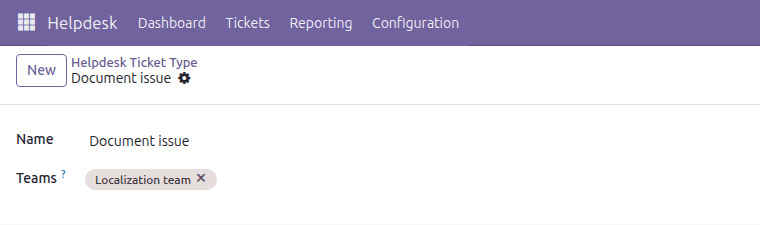
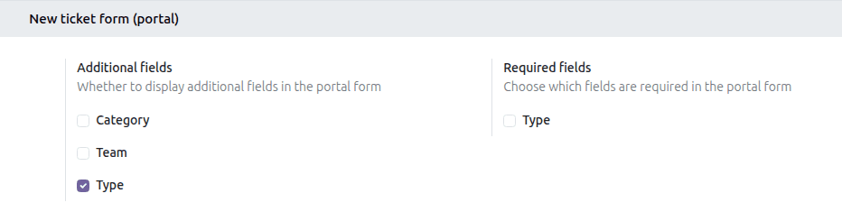

## Ticket types

- Go to Helpdesk \> Configuration \> Ticket Types
- Create your list of types
- Optionally, fill in the *Teams* field to restrict a type to those teams

The same restriction can be managed from the team side: go to Helpdesk \>
Configuration \> Teams, open a team and fill in the *Ticket Type* field.

## Portal

By default customers cannot choose a type when they submit a ticket from
the portal. To allow it:

- Go to Settings \> Helpdesk
- In the *New ticket form (portal)* section, under *Additional fields*,
  enable *Type*
- Optionally, under *Required fields*, enable *Type* to make the selection
  mandatory

These options are set per company.
