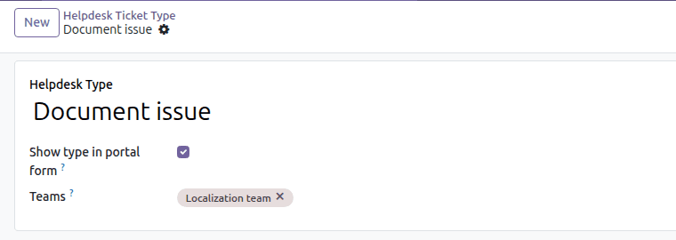
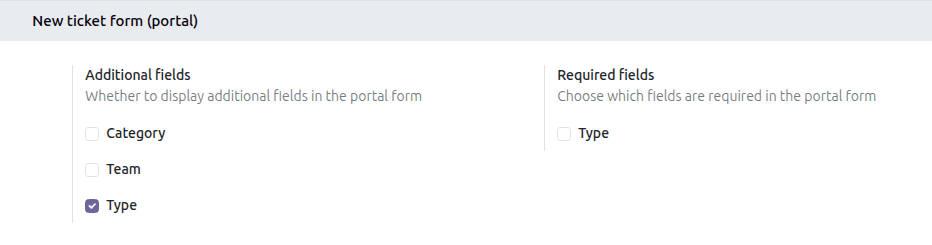

## Ticket types

- Go to Helpdesk \> Configuration \> Ticket Types
- Create your list of types
- In *Teams*, add every team that handles tickets of that type. A ticket
  can only be assigned to a team linked to its type: if a type has no
  teams, setting it on a ticket empties the ticket's team and assigned
  user.
- Keep *Show type in portal form* enabled (the default) if customers may
  choose this type in the portal.

The link between types and teams can also be managed from the team side:
go to Helpdesk \> Configuration \> Teams, open a team and fill in the
*Ticket Type* field.

## Portal

By default customers cannot choose a type when they submit a ticket from
the portal. To allow it:

- Go to Settings \> Helpdesk
- In the *New ticket form (portal)* section, under *Additional fields*,
  enable *Type*
- Optionally, under *Required fields*, enable *Type* to make the selection
  mandatory

These options are set per company. Only types with *Show type in portal
form* enabled are offered to customers.
