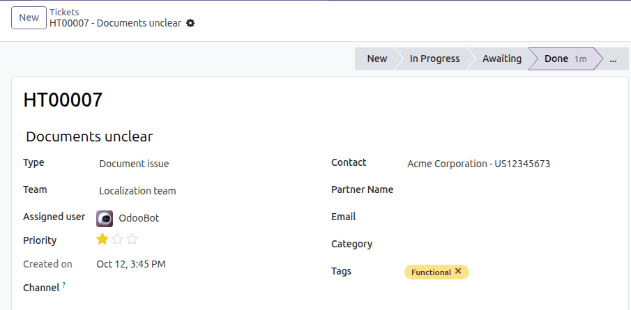
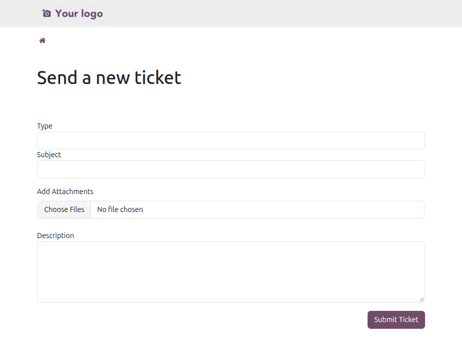

## Backend

- Go to Helpdesk
- Create a ticket and set its type.

Once a type is set, only the teams allowed for that type can be selected.
If the ticket already belongs to a team that does not use the selected
type, the team and the assigned user are emptied so the ticket can be
routed again.

The type is also shown on the kanban cards and as an optional column in the
list view, and tickets can be searched and grouped by type.

## Portal

When the *Type* option is enabled for the portal (see the configuration
section):

- Customers can select a type in the *Send a new ticket* form.
- The type is displayed in the customer's ticket list and on the ticket
  page.

